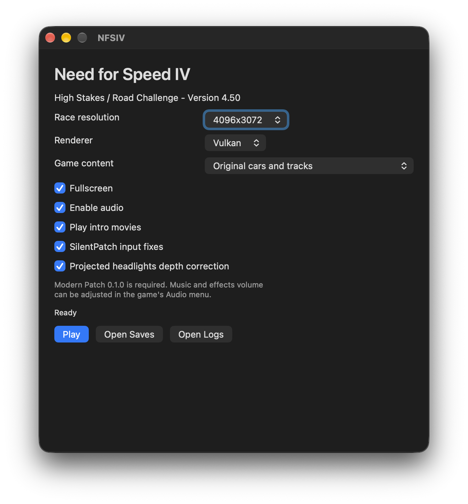

# NFS IV for Apple Silicon

Build a native ARM64 macOS app for **Need for Speed: High Stakes / Road Challenge (1999)** from your own PC game copy.

**This repository contains no EA game code, executables, music, movies, cars, tracks or other game assets. You must supply your own game copy.** The build downloads required patches and build dependencies from their original sources, verifies their SHA-256 checksums, and prepares the game locally. Game files, downloaded payloads, translated code and the resulting app are excluded from version control.



## Easiest way: NFSIV Builder

NFSIV Builder is a small app that installs what is missing and builds NFSIV.app from your own game copy. It needs an Apple Silicon Mac with **macOS 12 or newer**. On macOS 11, use [Build from Terminal](#build-from-terminal) instead.

1. Download `NFSIV-Builder.dmg` from the [Releases page](../../releases/latest) of this repository and open it. You do not need to copy NFSIV Builder anywhere.

**On macOS 14 or older:** right-click **NFSIV Builder** and choose **Open**.

**macOS 15 or newer:**

2. Run **NFSIV Builder** from the opened disk.
3. macOS says it cannot be opened. Click **Done**.
4. Open **System Settings**, then **Privacy & Security**, and scroll down.
5. Click **Open Anyway**.

NFSIV Builder is free and open source but not signed by Apple, so macOS asks once. The same steps are drawn on the disk's background.

The Builder shows a checklist:

- **Mac**: Apple Silicon and a supported macOS version.
- **Xcode command line tools**: **Install...** opens Apple's installer (about 2 GB).
- **Build tools (Python)**: the Builder downloads its own private Python into `~/Library/Application Support/NFSIV Builder` and sets up its packages (a private environment) in `~/Library/Caches/NFSIV`, about 70 MB of downloads in all. It never touches other Python installs.
- **Downloads**: VEG Modern Patch, MoltenVK, glslang and 7-Zip are downloaded during the build if they are not already cached. **Download** fetches them now.
- **Game copy**: click **Choose...** or drag a folder, `.iso`, `.bin`, `.img`, `.cue` or `.ccd` onto the window. Only the European Road Challenge CD is supported. If your copy is rejected, click **Which copy works?** to see the required file count, size and checksums next to what your copy has.
- **Destination**: where NFSIV.app is placed. The default is Applications.
- **Free disk space**: enough room for the build.

Below the list, tick **Include community cars and tracks** to add the High Stakes Expansion Pack's cars, tracks and pursuit traffic (an extra download and more disk space). Fix the red rows, then click **Build NFSIV.app**. When it finishes you can click **Play**, **Show in Finder** or **Remove build files**; your saves are never changed. The Builder shares the download cache `~/Library/Caches/NFSIV` with `./build.sh`.

## What you need

- An Apple Silicon Mac. NFSIV Builder needs macOS 12 or newer; the Terminal build and the game it produces support macOS 11 or newer.
- Xcode command line tools. NFSIV Builder offers to install them; for the Terminal build, install them once with `xcode-select --install`. These are the only part that comes from Apple.
- Python: NFSIV Builder installs its own. The Terminal build needs a native ARM64 **Python 3.11 or newer** with pip/venv, available as `python3`.
- Internet access for the first build's Python packages, patches and build dependencies.
- Your own supported game copy (see [Supported game copy](#supported-game-copy)).

## Build from Terminal

Run the following commands in this repository's directory:

```sh
./build.sh game.iso
open out/NFSIV.app
```

Use the same script for any supported input:

```sh
./build.sh "extracted game folder"
./build.sh disc.cue
./build.sh disc.bin
./build.sh disc.ccd
```

Replace the example input names with your game copy. An extracted folder must contain the original `DATA` and `SAVEDATA` directories and `NFSHS.ICO` from the retail disc root. Disc-image inputs include that icon automatically. For CUE, keep the referenced BIN/IMG alongside it. For CloneCD, keep the matching IMG beside the CCD; SUB subchannel data is not needed to extract the game. Supported images are ISO9660 ISO files and single-track, unscrambled MODE1 BIN/IMG/CUE/CCD images. Multi-track and other image layouts are rejected.

The script extracts images itself, verifies the extracted assets, fetches pinned dependencies, translates the game, compiles ARM64 binaries and creates an ad hoc signed `out/NFSIV.app`. No Windows installer, Homebrew installation or global Python package installation is required. Allow several gigabytes of free space for build files and caches. Keep the app private: it contains your game assets and translated game code.

To include selectable community cars, tracks and pursuit traffic:

```sh
./build.sh game.iso --community
```

Double-click the app, choose your resolution and renderer, then click **Play**. You can move the app to another folder; the bundled engine and Vulkan runtime use relative paths. The build does not notarize the app. Its icon comes from your supplied `NFSHS.ICO`, whose bitmap matches the original Windows executable icon. Packaging converts it to macOS ICNS; neither icon file is included in the repository.

## Supported game copy

The accepted source is the **pristine European retail release of Road Challenge**, with the English, Spanish and Swedish disc files (0409/040A/041D). This port runs in **English** and prepares the **4.50-based VEG Modern Patch 0.1.0** executable automatically. Supply the retail data before applying patches or mods; a previously modified installed folder is rejected. Other regional releases, demos, localized asset sets and prepatched collections have not been assigned accepted checksums.

The accepted-game SHA-256 is an **aggregate fingerprint of every extracted file under `DATA` and `SAVEDATA`**. It is not the checksum of a disc image or executable. ISO, BIN and IMG containers can have different checksums while holding the same accepted game files. The original icon is checked separately.

| What is checked | Exact files | Size in bytes | SHA-256 |
| --- | --- | ---: | --- |
| User-supplied retail assets | All 1,328 files under `DATA` and `SAVEDATA`, combined | 547,813,845 total | `73cb89e6dd4ea9ca32d02af2c822b22421cf9815e0c5557a3f6046671ed300d2` |
| User-supplied Windows icon | `NFSHS.ICO` at the retail disc root | 766 | `cd07cfab47d414f218838ed1b5b4f18478e0d0e2eda09bbd3fed47e86c5f2d2a` |
| Patched game executable, downloaded with VEG Modern Patch | `nfs4.exe` | 1,984,512 | `17a0f96c3bcfb94fc72d31a429ef56e14ec028e4a6ed1f692cdd8efc0b762980` |
| Sound module, downloaded with VEG Modern Patch | `eacsnd.dll` | 47,616 | `b23b61b85b3ad6b1d3f449e13a882585c254f271367bce5f932402163c9a358b` |

The asset size is the sum of the files' sizes, excluding the icon and directory metadata. Its aggregate hash is calculated from sorted, case-folded relative paths (including `data/` or `savedata/`), each followed by NUL and that file's raw SHA-256 digest. It cannot be reproduced by running `shasum` on the image or on a single file. The build calculates it after extraction; Finder metadata is ignored. A mismatch stops preparation and reports the detected inventory. Inputs are read without changing them. The two executable hashes identify the separate patched translation inputs, not the original retail executables.

## Features

- Native Cocoa launcher with saved resolution, renderer, fullscreen, audio, movie and optional fix selections.
- Vulkan rendering through bundled ARM64 MoltenVK, plus a native Metal renderer.
- Race resolutions from 640x480 to 4096x3072. Menus retain their original 640x480 artwork; fullscreen preserves the 4:3 picture with borders as needed.
- Borderless fullscreen, switchable while playing with F11 or the game's macOS View menu.
- Original keyboard/mouse controls, game menus, physics and AI.
- Sound effects, menu/race music and original movies with native CoreAudio output. Music and effects volumes remain adjustable in the game's Audio menu.
- Single-player racing, career progress, Hot Pursuit, local split-screen, replay and record files. A complete two-lap race, another race in the same session, career purchase/save/reload, pursuit and split-screen have been exercised.
- Optional SilentPatch input fixes and projected-headlight depth correction, independently selectable in the launcher.
- With `--community`: 70 car profiles, 30 track replacement profiles and one pursuit traffic profile from the Expansion Pack. Choose one content profile per launch; each has separate saves.

The community profiles are asset overlays, not a port of the Windows Mixer or IPLounge client. Original track names and unlock requirements can remain visible for replacement tracks. Preparation validates every profile, but every car/track combination has not been playtested. Network multiplayer, IPLounge, steering wheels and gamepads are not verified. This renderer does not implement the Windows Vulkan driver's widescreen FOV changes, MSAA/anisotropic-filtering controls or uncapped-FPS patches.

## Patches and dependencies

| Component | How this build uses it |
| --- | --- |
| [EA 4.50 update](https://community.pcgamingwiki.com/files/file/728-need-for-speed-high-stakes-internet-beta-test-patch/) | Required baseline, supplied by the verified VEG 4.50-derived executable and its five updated menu files. Those menus were compared byte-for-byte with the official patch payload. The separate Windows installer is not run or required. The earlier 4.42 update is superseded. |
| [VEG Modern Patch 0.1.0](https://veg.by/en/projects/nfs4/) | Required translation input and portable configuration, including the enlarged heap/car buffers. Downloaded directly from the author's site. Windows renderer DLLs are not used. |
| [SilentPatchNFS90s](https://github.com/CookiePLMonster/SilentPatchNFS90s) | Native implementation of the two NFS4 input HRESULT fixes, based on source revision `a25a586f83e5ba3e4c82eb23c6fe2e32e07fc313`. Optional launcher switch. This is a subset of SilentPatch; its Windows ASI/DLL is not loaded. Source notice retained. |
| Projected-headlight correction | Native depth bias for additive, non-depth-writing LEQUAL light decals. Optional launcher switch, enabled by default. |
| [High Stakes Expansion Pack](https://www.iplounge.net/) | Optional `--community` download from the IPLounge site's `hsfull.rar`. Extracts car/track assets and pursuit traffic without executing the installer or replacing the game executable. The traffic assets also match the Stock Pack copies. |
| [MoltenVK 1.2.11](https://github.com/KhronosGroup/MoltenVK/releases/tag/v1.2.11) | Bundled ARM64 Vulkan-to-Metal implementation. Downloaded from Khronos releases. |
| [glslang 14.3.0](https://github.com/KhronosGroup/glslang/releases/tag/14.3.0), [7-Zip 26.05](https://github.com/ip7z/7zip/releases/tag/26.05) | Build-time shader compiler and archive extractor, fetched from their upstream repositories. |

Game patch and native dependency archives have pinned SHA-256 values in `tools/build_app.py` and `tools/addons.py`; cached archives are checked again before reuse. Python dependencies are pinned in `requirements.txt` and installed into a private environment in the build cache. Jericho's Windows Vulkan driver, Stock Pack's Windows utilities and IPLounge are not required downloads: this project supplies its own native renderer and launcher.

## Saves, logs and rebuilding

Use **Open Saves** and **Open Logs** in the launcher to find your files. Saves, logs and prepared community profiles live in macOS Application Support, outside the app. Rebuilding preserves saves. A prepared community cache can be removed while the game is closed and will be recreated; retain the save profiles to keep progress.

Downloaded patches and private build tools use the macOS user cache by default. Each build retains a fresh prepared game and checksum metadata in ignored working directories. Earlier prepared copies can be removed when no longer needed. Generated translations and binaries are also excluded from version control.

```sh
./build.sh --help
./build.sh game.iso --prepare-only
./build.sh game.iso --cache build-cache --output out/MyNFSIV.app
```

`--prepare-only` extracts/verifies the source and prepares dependencies without translating or replacing the app. First-time shader compiler preparation still compiles a native build tool. If a download checksum changes, the build stops instead of accepting it. For game startup failures, inspect the newest log using **Open Logs**. Try Metal in the launcher to compare a graphics problem with Vulkan.

## Technical details: what is native?

Build-time Python tools disassemble the exact supported x86 game and EA sound module, lift their instructions into C, and compile approximately 7,738 functions into an ARM64 Mach-O executable with Apple clang. The resulting app executes compiled ARM64 game logic. It does not run Wine, Rosetta, an x86 interpreter, a JIT or a Windows virtual machine.

The port retains a 32-bit guest address space, explicit x86 register/flag state and original game data structures. Calls into Windows APIs are handled by a native C/Objective-C compatibility layer for files, memory, timing, input, display and sound. The original EA audio decoder is statically translated; CoreAudio plays its output. The Thrash graphics interface is implemented by native Vulkan and Metal backends, with project-owned shaders. Vulkan commands reach Apple's GPU through MoltenVK's Metal implementation.

This is a binary-derived port, not a source-level rewrite of the game. Private build output includes a linked PE image for original data and addresses, as well as compiled translations of game instructions. Original game assets remain required. Floating-point emulation uses host double precision rather than reproducing every x87 80-bit intermediate, and unexercised code paths can still expose compatibility gaps. Original offline behavior is preserved where tested; this is not a claim that every Windows API, mode or community patch has been ported.

The repository contains build tools, the native compatibility layer, launcher, shaders, synthetic tests and third-party notices. EA-derived generated files and assets belong only in ignored local build output. The third-party notices in this repository document upstream provenance and reuse terms. The inherited NFSU2Recomp portions permit personal local use and modification; redistribution requires the copyright holder's permission under the retained license. No game or app download is supplied by this repository.
